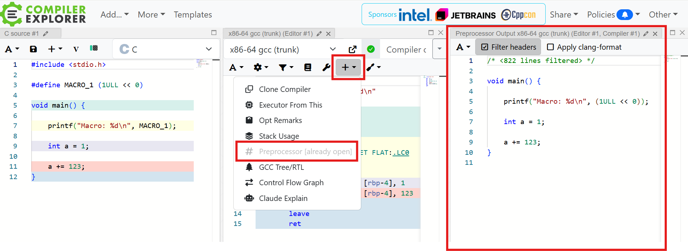

# Microsoft SAL in UCRT

UCRT is the new C runtime / standard library of Microsoft on windows. The U stands for unified.

UCRT is partly defined in header files which contain a feature called SAL, the Source Code Annotation Langauge.

SAL adds token into the source code which are read by static code analysis in order to improve stability of C-Code during the development phase. SAL allows to flag parameters as optional or mandatory so that static code analysis can check if a mandatory paramater has a NULL value assigned. Another check is if parameters are in range or if strings are zero-terminated.

The token are only understood by Microsoft's MSVC (Visual Studio) compiler. GCC, clang and other compilers will not understand the token and throw syntax errors.

Some SAL token are:

_In_opt_z_

_In_ (Input) - a function will only read this parameter. The callee expects the caller to provide valid data.

_opt_ (Optional) - a parameter is optional. If it is a pointer, the pointer is allowed to be NULL or nullptr.

_z_ (Null-terminated) - the callee expects a zero/null-terminated string.

_Field_range_(min, max) - e.g. _Field_range_(1, 1024) the variable is allowed to have a value in the range of [1, 1024].

_Printf_format_string_ - ???

 _Printf_format_string_params_(2) - states how many parameters are expected for a function call. Used with variadic functions such as printf() in order to check if a parameter is provided for each placeholder in the format string.

 _Scanf_format_string_params_(2) - ???

 _Check_return_ - ???

 __declspec(noinline) __inline

 wint_t __cdecl

# Testing the Preprocessor

A quick way of testing the output of the preprocessor without installing any software or figuring out compiler flags is to enable the preprocessor tool in the online compiler explorer (aka. godbolt).

The compiler explorer is available under https://godbolt.org/

When selecting the compiler x86-64 gcc (trunk), the preprocessor tool is available using the "+ Add New..." drop down menu and selecting the option "# Preprocessor".



Inside the preprocessor view which opens up on the right side, the output of the preprocessor before it hits the compiler is displayed.

You can now paste your scripts and check how gcc preprocesses them.

# Preprocessor

The compilation of the core of the C programming language does not contain comments and
also it does not specify header files! The compiled C code only consists of .c files containing pure C code! The compiler itself will not deal with includes, comments or preprocessor instructions! The C language specification instead defines a preprocessor which takes care of including files, removing comments and replacing macros.

The preprocessor takes a singular .c file as an input and starts to form a compilation unit.
It is not possible to specify more than a single .c file as input to the preprocessor at a time.

The preprocessor now starts to process the compilation unit and it will extend it
by resolving included (#include) header files (recursively, if a header includes another header)
and pasting the header file's literal content into the compilation unit.
Next, the preprocessor will remove comments (single- and mulitline) and replace them by a single space.
Following, the preprocessor will replace defined (#define) symbols by their definition.

The output of the preprocessor is one large .c file that contains the entire
compilation unit and adheres to some type of the C-specification (e.g. C99) which
can then be processed by a C-compiler that also adheres to that same type of specification.

At this point, there are no more .h files to process as the preprocessor has pasted the .h
files into the compilation unit. The C-compiler will never touch any .h files! The compiler's
output is a single object (.o) file per preprocessed .c file / compilation unit.

After preprocessing, there is a set of .o files, one .o per compilation unit. This means that the
preprocessor does not combine all input .c files into one large compilation unit but
instead it outputs a distinct compilation unit per input .c file!

This also means that the compiler will not compile several .c compilation units
into one large .o file but the compiler will output one object file per input compilation unit.
Every call to the compiler will have a single .c file as input.

Finally the linker will combine all .o files along with specified library files into a
final library or executable.


## Preprocessor Instructions (PPI)

A preprocessor instruction (PPI) extends over a single line only! The line has to start with a pound (#) sign (whitespace are allowed). If a line does not start with a pound sign, it is not a PPI line. A newline terminates the line!

The \ character makes the preprocessor ignore the next newline character while it parses PPI. This is used to write PPI spanning several lines and make the preprocessor treat the entire definition as a single line definition. This is a convenience feature to improve the readabilty of the source-code but will not otherwise affect the functionality of the preprocessor.

### List of PPI

These PPI exist:

Makros:
```
#define <symbol> <replacement_text>
#undef <symbol>
```

Conditional Compilation
```
#ifdef
#ifndef

#if
#elif
#else
#endif
```

File inclusion
```
#include
```

#error and #pragma
```
#error
#pragma
```

Line output
```
#line
```

A special type of #if exists:

```
#if defined(<symbol>)
#elif defined(<symbol>)
```

This special type checks if a symbol is defined using the operator defined(<symbol>)

The stringizer operator: #
The concatenation operator: ##

The hex file embed operator: #embed <filename>
https://stackoverflow.com/questions/80011157/what-is-difference-between-embed-and-include-in-c


### Stringizing

Stringizing is performed using the operator #.

```
#define stringer( x ) printf_s( #x "\n" )
```

The stringizer operator (#) will
- wrap all arguments in double quotes
- escape special characters encountered in the arguments

Input:

```
// stringizer.cpp
#include <stdio.h>
#define stringer( x ) printf_s( #x "\n" )
int main() {
    stringer ( In quotes in the printf function call );
    stringer ( "In quotes when printed to the screen" );
    stringer ( "This: \" prints an escaped double quote" );
}
```

Output:

```
int main() {
    printf_s ( "In quotes in the printf function call" "\n" );
    printf_s ( "\"In quotes when printed to the screen\"" "\n" );
    printf_s ( "\"This: \\\" prints an escaped double quote"" "\n" );
}
```


# Parsing and applying PPI

The Preprocessor uses a lexer (but no parser since no grammar can be formulated as some parts
of the input are allowed to be free-text without any formal specification to them).

The lexer has to feed individual token to the preprocessor.

The preprocessor consumes PPI until the current line is over.

Once consumed, the preprocessor changes roles away from being a parser and now shows the
behaviour of an interpreter. It will execute PPI such as #if, #elif, #ifdef, #ifndef, #define,
#undef and others. As an interpreter it uses the information it has learned from the execution
of PPI on previous lines and execute the current PPI.

The preprocessor will not output new PPI which means that after the first pass, the preprocessor is done with a file.

# Parsing PP instructions (PPI)

## Expression Parser

In order to execute #if statements for example, the if-predicate has to be evaluated to a true or
false value. To interpret the predicate it is converted into a tree. The predicate therefore
needs to be well-formed. It is the expression parsers job to convert the predicate into a tree.

The expression parser uses the following priorities for token:
(A higher number sinks down into the tree further/deeper than a smaller number.)

```

( - Weight During Insert: 99999. Weight after Insert: 10. The update in weight is not needed when the insert ptr is moved to the ( node
) - Weight During Insert: 99999. Weight after Insert: 20. The update in weight is not needed when the insert ptr is moved to the ( node

&& - 180
|| - 200

! - 300
, - 320
== - 340

+ - 400
- - 410
* - 420
/ - 430

| - ???

defined - 500


() - 900

<identifier> - 1000
<numeric> - 1000
```

The expression parser outputs an AST-Node of trees that represents the expression.

To improve the parsing, an opening bracket temporarily becomes the new point of
insertion into the tree by moving the insertion pointer to that opening bracket node.
Any subsequent token are inserted at the node pointed to by the insertion pointer and
not at the root node. Once the closing bracket is matche by a opening bracket, the
opening bracket node changes into a () node and the insertion pointer is moved up the
tree to the previous opening bracket node.

## Parsing the #define PPI

The format is:

```
#define <macro_interface> <replacement_text>
```

The <macro_interface> consists of the mandatory macro name followed
by optional parameters. The parameters are a comma separated list wrapped
in brackets. The <replacement_text> is free-form text and does not have
to be well-formed i.e. needs to be convertible into a binary tree. The
<replacement_text> is optional. If a macro is not defined at all or is
defined without <replacement_text>, it's value is defined to be 0 when
evaluated.

To manage all defines, the preprocessor uses a struct for defines.
A define is implemented as a struct that looks like this:

```
{
    name
    list_of_parameters
    definition/replacement_text
}
```

The preprocessor will maintain a hashmap which maps from the define's name to that
define struct for fast lookup and retrieval of defines, when they are encountered
in the source code and when each individual token in the input stream needs
to be checked if it is a defined symbol.

As an example, the following define has an interface consisting of name and
parameter list and a definition which additionally is well-formed and could in theory
be parsed by an expression parser:

```
#define max(a,b) ((a) >= (b) ? (a) : (b))
```

This define yields a <macro_interface> which is the following AST:

```
        () <--- ptr
        |
     --------
     |      |
	max		,
            |
        ---------
        |       |
		a       b
```

The define struct's name is filled with the extracted value 'max'.
The efine struct's list_of_parameters is extracted from the AST to be 'a', 'b' in exactly that order.

The following define is different to the first example:

```
#define _SAL1_Source_(Name, args, annotes) _SA_annotes3(SAL_name, #Name, "", "1") _GrouP_(annotes _SAL_nop_impl_)
```

While it also has a <macro_interface> with name and parameter list, it's <replacement_text>
is free-form text and not well-formed text. The <replacement_text> cannot be parsed into
a binary tree!

A normal Expression parser cannot correctly parse both expressions because it does
not use a grammar and no recursive decent parser or the likes. A grammar cannot
be use since anything can be put in a #define and there is no grammar that
captures all possibilities.

Another example is this define:

```
#define _Analysis_mode_(mode)                                                 \
    __pragma(warning(disable: 28110 28111 28161 28162))                       \
    typedef _Analysis_mode_impl_(mode) int                                    \
        __GENSYM(__prefast_analysis_mode_flag);
```

This define cannot be parsed into a working tree easily.

Therefore, the way defines are treating will work on a very low level
of formality.

NOTE: PPI such as #if, #elif, #if defined() must contain well-formed expressions!
The reason is that the expressions need to be parsed into an expression tree
by an expression parser and the expression tree needs to be evaluated using actual
parameter values! This means that in contrast to #define PPI, the #if etc. PPI
need to contain a well-formed tree!

The way #define is resolved is:

The entire #define macro_definitions are treated as a single large string.
In a loop, defined symbols are replaced in the string.
Because a defined symbol can be resolved to even more defined symbols, the
loop needs to iterate as long as there are unresolved defined symbols in
the large string. One edge-case is an endless loop which can be created
by having a cycle of defines which resolve into each other. Because the
cycle closes back to the first define, it will loop forever. A mecanism
which detects loops needs to be provided.

### Resolving a #define (when it is found in the token stream)

This is not how the defines are actually handled!
It was written before I realized that #defines are not well-formed
and cannot always be parsed by an expression parser.

When a defined symbol is detected in the token stream,
1. the define struct is retrieved from the map of defines
1. the define struct is deep-cloned (because it will be modified in the next steps)
1. the actual parameters are extracted from the occurence in the token stream
1. the actual paramater value is replaced in all AST nodes in the define struct's list_of_ASTs
1. All the ASTs (with their formal parameters replaced for the actual parameters) are output to the destination file

### Sample Data

```
#define max(a,b) ((a) >= (b) ? (a) : (b))

#define _Deref_ret3_impl_(p1,p2,p3)

#define _SAL1_Source_(Name, args, annotes) _SA_annotes3(SAL_name, #Name, "", "1") _GrouP_(annotes _SAL_nop_impl_)
#define _SAL1_1_Source_(Name, args, annotes) _SA_annotes3(SAL_name, #Name, "", "1.1") _GrouP_(annotes _SAL_nop_impl_)
#define _SAL1_2_Source_(Name, args, annotes) _SA_annotes3(SAL_name, #Name, "", "1.2") _GrouP_(annotes _SAL_nop_impl_)
#define _SAL2_Source_(Name, args, annotes) _SA_annotes3(SAL_name, #Name, "", "2") _GrouP_(annotes _SAL_nop_impl_)

#define _Reserved_                      _SAL2_Source_(_Reserved_, (), _Pre1_impl_(__null_impl))

#define _Success_impl_(expr)            [__M_(__d_=0)]

#define _CRT_UNPARENTHESIZE_(...) __VA_ARGS__
#define _CRT_UNPARENTHESIZE(...)  _CRT_UNPARENTHESIZE_ __VA_ARGS__

#define __crt_countof(_Array) (sizeof(_Array) / sizeof(_Array[0]))

#define _CRT_DEPRECATE_TEXT(_Text) __declspec(deprecated(_Text))

#define __vcrt_calloc_normal(_Count, _Size) calloc(_Count, _Size)
```


## Parsing if-instruction

The #if PP instruction consists of a single part called the predicate,
which is parsed using the expression parser.

The format is:

```
#if <expression>
```

### Resolving an if-instruction (when it is found in the token stream)

When a #if symbol is detected in the token stream,
1. the #if content is parsed using an expression parser
1. the actual parameters are extracted from the occurence in the token stream
1. the actual paramater value is replaced in all AST nodes in the define struct's list_of_ASTs
1. The tree is evaluated into a boolean value
1. The #if is either branched into or not based on the boolean value.

### Sample Data

```
#if _USE_DECLSPECS_FOR_SAL && ( defined(MIDL_PASS) || defined(__midl) || defined(RC_INVOKED) || !defined(_PREFAST_) )

#ifndef _VCRTIMP
    #if defined _CRTIMP && !defined _VCRT_DEFINED_CRTIMP
        #define _VCRTIMP _CRTIMP
    #elif defined _VCRT_BUILD && defined CRTDLL && !defined _VCRT_SAT_1
        #define _VCRTIMP __declspec(dllexport)
    #else
        #define _VCRTIMP
    #endif
#endif

#if defined _M_X64 || defined _M_ARM || defined _M_ARM64
    #define _UNALIGNED __unaligned
#else
    #define _UNALIGNED
#endif

#ifndef _CRT_USE_WINAPI_FAMILY_DESKTOP_APP
    #ifdef WINAPI_FAMILY
        #include <winapifamily.h>
        #if WINAPI_FAMILY_PARTITION(WINAPI_PARTITION_DESKTOP | WINAPI_PARTITION_SYSTEM)
            #define _CRT_USE_WINAPI_FAMILY_DESKTOP_APP
        #else
            #ifdef WINAPI_FAMILY_PHONE_APP
                #if WINAPI_FAMILY == WINAPI_FAMILY_PHONE_APP
                    #define _CRT_USE_WINAPI_FAMILY_PHONE_APP
                #endif
            #endif

            #ifdef WINAPI_FAMILY_GAMES
                #if WINAPI_FAMILY == WINAPI_FAMILY_GAMES
                    #define _CRT_USE_WINAPI_FAMILY_GAMES
                #endif
            #endif
        #endif
    #else
        #define _CRT_USE_WINAPI_FAMILY_DESKTOP_APP
    #endif
#endif
```

## Parsing ifndef

### Sample Data

```
#ifndef _CRT_INSECURE_DEPRECATE
    #ifdef _CRT_SECURE_NO_WARNINGS
        #define _CRT_INSECURE_DEPRECATE(_Replacement)
    #else
        #define _CRT_INSECURE_DEPRECATE(_Replacement) _CRT_DEPRECATE_TEXT(    \
            "This function or variable may be unsafe. Consider using "        \
            #_Replacement                                                     \
            " instead. To disable deprecation, use _CRT_SECURE_NO_WARNINGS. " \
            "See online help for details.")
    #endif
#endif
```

### Parsing pragma PPI

Just consume the text to the end of the line.

Format
```
#pragma <data>
```

### Sample Data

```
#pragma pop_macro("constexpr")
#pragma pop_macro("msvc")
```

### Parsing error PPI

Just consume the text to the end of the line.

Format
```
#pragma <error_text>
```

### Sample Data

```
#error Compiling Desktop applications for the ARM platform is not supported.
```


### Parsing the #define PPI

```
#define <symbol> <expression>
```

```
#define _DEBUG
#define BUFSIZE 1

#define DIMENSION 4
#define ELEMENTS DIMENSION * DIMENSION

#define EXPR_A (2 + 3)

#define abs(x)   ((x) >= 0 ? (x) : -(x))
#define min(a,b) ((a) <= (b) ? (a) : (b))
#define max(a,b) ((a) >= (b) ? (a) : (b))

#define SQUARE(x) ((x) * (x))
```

There is on nasty edge-case which makes parsing more complicated!
The interface has an optional parameter list and the definition is
allowed to be wrapped in brackets!

```
#define EXPR_A (2 + 3)
```

Here, identifying the interface 'EXPR_A' and the definition '(2 + 3)'
is hard because brackets cannot be used in a straightforward fashion
as a lookahead to distinguish between the parameter list and the definition
since with a single token of lookahead, the parameter list and the
definition look the same!

The preprocessor, once it encounters a PPI, has to parse that PPI into an
AST of tree nodes that captures the expression.
As the lexer outputs token, the are immediately processed.
Once the newline character is encountered
(remember: every PPI spans a single line only! Therefore newline can
be used to detect the end of the PPI), then the data parsed so far is
added to the internal data store of all defined symbols.

#define PPI are a special case. Only the first part, the macro_interface
is a well-formed string which can be parsed into an AST. The second part,
the macro-definition is not well-formed an can be any text, even non-formalized
text.

An example for a #defin PPI is the line:

```
#define SQUARE(x) ((x) * (x))
```

The macro interface is SQUARE(x) which is well-formed and can be
parsed into an AST by the expression parser. In this example,
the second part ((x) * (x)) is also well-formed but in general
any text is allowed.

NOTE: #if, #elif, #if define PPI are different. Because the
preprocessor needs to evaluate the predicate to a true or false
value, the content of the #if statements need to always be
wellformed text which can be parsed into an AST!

First, the preprocessor parses the macro interface into the
following AST:

```
       ()
       |
    -------
    |     |
 SQUARE   x
```

The AST is created using the weighted sink-down algorithm as the token are parsed.

The following information is created by the preprocessor:

```
Symbol {
	name: "SQUARE"
	formal_parameter_map: { key: 0, value: x }
	definition: "((x) * (x))"
}
```

name is the name of the Symbol
The formal_parameter_map contains entries, one entry per formal parameter.
The key is the index (0 means first formal parameter, 1 means second formal parameter, ...)
The value is the name of the formal parameter so it can be recognized within the
macro definition.

Building the AST of the macro definition is not performed!
The macro definition is stored as a string!

### Sample Data #define PPI

```
#define _DEBUG
#define BUFSIZE 1

#define DIMENSION 4
#define ELEMENTS DIMENSION * DIMENSION

#define EXPR_A (2 + 3)

#define abs(x)   ((x) >= 0 ? (x) : -(x))
#define min(a,b) ((a) <= (b) ? (a) : (b))
#define max(a,b) ((a) >= (b) ? (a) : (b))

#define SQUARE(x) ((x) * (x))
```


### Applying the #define PPI

As an example:

```
printf("Square of 4: %d\n", SQUARE(4));
```

As this line does not start with a PPI, the preprocessor is in an operating mode which could
be described as NORMAL-mode.

In NORMAL-mode, for every token, the preprocessor looks up the token in the internal data store.
If the token is contained in the data store, instead of outputting the token, it is replaced by
the defined macro definition. Before replacing, the defined value is filled with actual
parameters in place of all the formal parameters it contains.

NOTE: There should also be a type-checking phase to see if all required formal parameters
are actually provided with actual parameters! Otherwise the macro is applied incorrectly
and the preprocessor should quit with an error message.

In the example above, the token SQUARE(4) is found in the data store.
The defintion is:

```
DefineSymbol {
	name: "SQUARE"
	formal_parameter_map: { key: 0, value: x }
	definition: "((x) * (x))"
}
```

The String from the symbol definition in the datastore is first cloned because a copy is required
since the next step will alter the String.

Next the formal parameter at index 0 which is called x is replaced by the actual parameter 4
in the cloned String and then the entire String is output where the original symbol would go.

The result is:

```
printf("Square of 4: %d\n", ((4) * (4)));
```


### Parsing the #if PPI

```
#if <expression>
```

The special thing about #if PPI is that the expression must be well-formed
meaning that it can be parsed into an AST by an Expression parser!

The <epression> is parsed into an AST as the lexer emits token.
The AST is created using the weighted-sink-down algorithm as the token are parsed.

When the newline character is encountered, a semantic analysis phase starts and
the type checker checks if for each formal parameter an actual value is provided.
If there is any error, the preprocessor exits with an error message.

After sematic analysis the expression AST node is evaluated.

If the expression evaluates to true, then in the execution phase, the if-stack
is consulted. First the topmost if-stack element is peeked and it is checked, if
this frame is deactivated or not.

If it is not deactivated, a new IfStackFrame is pushed on top of the stack
for the current if-statement and the predicate is evaluated.
If it evaluates to true, the if statement is executed.

### Sample Data

```
#if defined(_DEBUG) || defined(_UNIT_TEST)
  printf("a");
  #if defined(_DEBUG_INNER) || defined(_UNIT_TEST_INNER)
    printf("b");
  #elif defined(_DEBUG_INNER_2) || defined(_UNIT_TEST_INNER_2)
    printf("c");
  #else
    printf("d");
  #endif
#else
  printf("e");
#endif
```


### Applying the #if PPI

As an example:

```
printf("Square of 4: %d\n", SQUARE(4));
```


### Parsing the #include PPI

### Applying the #include PPI

The basic idea behind dealing with include files (and also normal .c files)
is that of the FileStackFrame class and using the FileStackFrame-Stack to house
those FileStackFrameS.

Every file that the preprocessor processes becomes an instance of FileStackFrame.
The instance is pushed onto the FileStackFrame-Stack as long as it is processed.
When the file is fully processed, the FileStackFrame pops itself from the stack
and the preprocessor continues to process the stackframe the is the current frame.
Once there are no more frames on the stack, the preprocessor is done.

Everything begins with the .c file which forms the core of the compilation unit.
This compilation unit is extended by included header files.
This first .c file is created into a FileStackFrame and that frame is pushed onto
the stack.

When a #include PPI is executed, the target header file is looked up and a new
FileStackFrame is created for that include file and it is pushed onto the stack.
When the include file is fully consumed and executed, it pops itself from the
stack and the stack and the execution returns to the last FileStackFrame which
now again forms the current FileStackFrame.

This system was devised so that the preprocessor can recursively parse files.
The starting .c file branches into header files which itself again can include
further .h files. When a file is done, the recursion returns one level and pops
the current frame from the stack until everything is done.


# The Preprocessor

Many tests:

https://github.com/Thewbi/cpp_compiler/tree/main/src/test/resources/preprocessor

??? Backslash-Newline sequences are deleted, no matter where.

```
#define
#elif
#else
#endif
#error
#if
#ifdef
#ifndef
#import
#include
#line
#pragma
#undef
#using
```

https://github.com/Thewbi/cpp_compiler/blob/main/src/main/java/preprocessor/SimpleFileStackFrame.java

The input is a single compilation unit which is a .c file which draws in many .h files which in turn
may also draw in more .h files by including them. The output is one large.c file with all the values
from the .c and all included .h files. If two or more .h files for a loop by cyclicly including themselves,
the loop is broken by including each .h file at most once.

.h files are identified by their absolute or relative path. Relative paths need one or more base paths
to be resolved into absolute paths. Based on the type of #include symbol the use of paths change.
For chevron includes (#include <stdio.h>) the base paths are toolchain system paths and -I command line inputs.
For quote includes (#include "test.h") the include paths are resolved relative to the currently
process file (.c or .h).

A SimpleFileStackFrame object stands for either the main.c or any of the included files which.
Every included .h file is represented by it's own SimpleFileStackFrame.

SimpleFileStackFrame will use a lexer only to process the file. The preprocessor knows nothing
about the C grammar, it is a text processor.

The preprocessor iterates over the token it scans from the input file of the SimpleFileStackFrame.
There is a large if-else statement for each type of token.

As the preprocessor (implemented inside SimpleFileStackFrame) scans through the input it enters
different modes based on the items it has seen last. For example if an expression is detected,
it will enter ParserMode.EXPRESSION. It uses a hand-crafted expression parser to build trees from expressions.

Every if case in the large it-statement is created for a specific token-type. Within the branches,
there is a second if-else statement for the different modes that the preprocessor can be in.

As the preprocessor goes, it will build up different #define objects and store them into a datastructure
for later application in normal text. There is only one #define object data store for the entire
translation unit. This means #define object from included header files are also used when processing
the base .c file which has performed the include and also when processing all subsequent .h files.

If a token is normal text (no preprocessor token), then the normal text is compared to the #define objects
in the database. If the normal text matches one of the #define objects, the #define object is applied.
This means that the formal parameters need to be replaced by actual parameters, and the normal text is
replaced by the processed #define object and the newly replaced text is output by the preprocessor into
the large resulting StringBuffer or text file.

The functions filterByPreprocessorValues() and evaluatePreprocessorTreeNode() are used to perform these
replacement steps.

As an example, take a look at the SQUARE(x) #define object:

```
#define SQUARE(x) ((x) * (x))
```

When SQUARE is processed, it's expression x * x is parsed and inserted into the database. Whenever SQUARE
is encountered in normal text, it's formal parameter x is replaced and the replaced expression is output.

```
int a = SQUARE(5);
```

is replaced by

```
int a  = ((5) * (5));
```

```
/**
 * This function contains the basic idea of the algorithm. The purpose of the
 * algorithm is to parse expressions without a parser, using a lexer and token
 * only.
 * The expression is represented using a binary tree.
 * To build the tree, all token types are identified and if the token is a C/C++
 * operator, the precedence of that operator is used as a weight. The heavier
 * the node (higher precedence) the deeper the token will sink into the tree.
 * Literals have the highest weight and will sink down and act as the leafs of
 * the tree (Leaf == no children).
 */
```


# Comments

Needs to remove comments by a single space.

Removes comments (single line // and multiline comments are removed /* */
and replaced by a single space character).

Comments are not part of the C-grammar! This means the C-compiler cannot process comments.
This is the reason why the preprocessor needs to remove comments!

## Single line comment

```
// single line comment on it's own

int a = 1; // single line comment after a instruction
```

## Multiline Comment (Standard C comment)

```
/* test */

/* test
*/

/*
 * Extended shape
 */

printf("Hello World! %s %s %d", "a"/*a*/, "b"/*b*/, 5/*c*/); // interleaved multiline
```


# AST Construction Examples

## Example 1

```
Input:
#if _USE_DECLSPECS_FOR_SAL && ( defined(MIDL_PASS) || defined(__midl) || defined(RC_INVOKED) || !defined(_PREFAST_) ) // [

#if:
						#if <--- ptr


_USE_DECLSPECS_FOR_SAL:
                        #if <--- ptr      // goes into the RHS of '#if' or '#if' moves everthing into RHS
                            _USE_DECLSPECS_FOR_SAL


&&:
						    #if <--- ptr
						                                &&
                                _USE_DECLSPECS_FOR_SAL

(:
						    #if
						                                &&  <------------------------------ Cannot enter '(' into LHS because there is a heavier object there already
                                _USE_DECLSPECS_FOR_SAL      ( <--- ptr


defined:
							#if
						                                &&
                                _USE_DECLSPECS_FOR_SAL      ( <--- ptr
                                                               defined     // 'defined' goes into the RHS of '(' or '(' moves everthing into RHS

(:
							#if
						                                &&
                                _USE_DECLSPECS_FOR_SAL      (
                                                                defined		// defined moves nodes into it's RHS
								                                        ( <--- ptr

MIDL_PASS:
							#if
						                                &&
                                _USE_DECLSPECS_FOR_SAL      (
                                                                defined
								                                        ( <--- ptr
										                                    MIDL_PASS ( 'MIDL_PASS' goes into the RHS of '(' or '(' moves everthing into RHS )

):
                            #if
						                                &&
                                _USE_DECLSPECS_FOR_SAL      ( <--- ptr
                                                                defined
								                                        ()     			// ')' closes the open bracket, the pointer moves up to the first open bracket
										                                    MIDL_PASS


||:
							#if
														&&
								_USE_DECLSPECS_FOR_SAL      ( <--- ptr
																||        				// '||' is less heavy than 'defined' and becomes new parent. '||' It goes RHS of '('. The old right child goes LHS)
														defined
																()
																	MIDL_PASS


defined:
							#if
														&&
                                _USE_DECLSPECS_FOR_SAL      ( <--- ptr
													            ||
                                                        defined       defined			// 'defined' goes right
								                                ()
																	MIDL_PASS


							#if
						                                &&
                                _USE_DECLSPECS_FOR_SAL      ( <--- ptr
													            ||
														defined             defined
														        ()                   ()
																	MIDL_PASS          __midl

||:
							#if
														&&
								_USE_DECLSPECS_FOR_SAL      ( <--- ptr
																		||    					// '||' becomes parent of '||'. Child goes LHS
													 ||
                                            defined        defined
								    ()                   ()
										MIDL_PASS          __midl


defined(RC_INVOKED):
							#if
														&&
								_USE_DECLSPECS_FOR_SAL      ( <--- ptr
																		||
													 ||							  defined
                                       defined             defined				()
								    ()                   ()						  RC_INVOKED
										MIDL_PASS          __midl


||:
							#if
														&&
								_USE_DECLSPECS_FOR_SAL      ( <--- ptr
                                                                                               ||
																		||
													 ||							  defined
                                        defined            defined				()
								    ()                   ()						  RC_INVOKED
										MIDL_PASS          __midl


!:
							#if
														&&
								_USE_DECLSPECS_FOR_SAL      ( <--- ptr
                                                                                               ||
																		||                               !      // '!' is heavier than '||'
													 ||							  defined
                                        defined            defined				()
								    ()                   ()						  RC_INVOKED
										MIDL_PASS          __midl


defined(_PREFAST_):
							#if
														&&
								_USE_DECLSPECS_FOR_SAL      ( <--- ptr
                                                                                               ||
																		||                                     ! 	// 'define' is heavier than '!'
													 ||							  defined               defined
                                        defined            defined				()                     ()
								    ()                   ()						  RC_INVOKED             _PREFAST_
										MIDL_PASS          __midl


):
							#if <--- ptr
														&&
								_USE_DECLSPECS_FOR_SAL      ()
                                                                                               ||
																		||                                     !
													 ||							  defined               defined
                                        defined            defined				()                     ()
								    ()                   ()						  RC_INVOKED             _PREFAST_
										MIDL_PASS          __midl
```

## Example 2

```
Input:
(sizeof(_Array) / sizeof(_Array[0]))


(:
						( <--- ptr


sizeof:
						( <--- ptr			// sizeof goes LHS
							sizeof


(:
						(
									(	<--- ptr			// '(' is lighter than sizeof. A reparent operation takes place. The old child is reparented LHS
							sizeof


_Array:
						(
									(	<--- ptr			// '_Array' is inserted at the current ptr location!
							sizeof		_Array


):
						( <--- ptr
									()
							sizeof		_Array


/:
						( <--- ptr
												/			// reparent takes place. old child goes LHS
									()
							sizeof		_Array


sizeof:
						( <--- ptr
												/			// cannot insert sizeof LHS because the bracket is closed already and accepts nothing.
									()		          sizeof
							sizeof		_Array


(:
						(
												/
									()					        ( <--- ptr			// A reparent takes place. old child inserted RHS '(' moves everything to the RHS
							sizeof		_Array			sizeof


_Array[0]:
						(
												/
									()					   		( <--- ptr
							sizeof		_Array			sizeof		_Array[0]


):
						( <--- ptr
												/
									()					   		()
							sizeof		_Array			sizeof		_Array[0]


):
						() <--- ptr
												/
									()					   		()
							sizeof		_Array			sizeof		_Array[0]


OUTPUT INORDER

Exception: The () node outputs ( inorder and the ) postorder! It outputs two symbols!

( sizeof(_Array) / sizeof(_Array[0]) )
```

## Example 3

```
Input:
_GrouP_(annotes _SAL_nop_impl_)


_GrouP_:
				_GrouP_		<-- ptr


(:
							( <-- ptr			// reparent operation takes place. Old child goes LHS.
				_GrouP_


annotes:
							( <-- ptr			// reparent operation takes place. Old child goes LHS.
				_GrouP_				annotes


_SAL_nop_impl_:
							( <-- ptr
				_GrouP_				annotes						// a string meets a string. string goes RHS !!!!
												_SAL_nop_impl_


):
							() <-- ptr
				_GrouP_				annotes
												_SAL_nop_impl_


INORDER OUTPUT

_GrouP_ ( annotes _SAL_nop_impl_ )
```

## Example 4

```
Input:
_SA_annotes3(SAL_name, #Name, "", "1") _GrouP_(annotes _SAL_nop_impl_)


_SA_annotes3:
				_SA_annotes3 <-- ptr


(:
							( <-- ptr			// reparent operation takes place. Old child goes LHS.
				_SA_annotes3


SAL_name:
							( <-- ptr
				_SA_annotes3	SAL_name


,:
							( <-- ptr
				_SA_annotes3	         , // reparent operation takes place. Old child goes LHS.
								SAL_name


#Name:
							( <-- ptr
				_SA_annotes3	         , // LHS is used, #Name goes RHS
								SAL_name    #Name


,:
							( <-- ptr
				_SA_annotes3	                   , 	// reparent operation takes place. Old child goes LHS.
				                          ,
								SAL_name    #Name


"":
							( <-- ptr
				_SA_annotes3	                   ,
				                          ,            ""
								SAL_name    #Name


,:
							( <-- ptr
				_SA_annotes3	                                ,		// reparent operation takes place. Old child goes LHS.
                                                  ,
				                          ,             ""
								SAL_name    #Name


"1":
							( <-- ptr
				_SA_annotes3	                                ,
                                                  ,				       "1"
				                          ,             ""
								SAL_name    #Name


")":
							() <-- ptr
				_SA_annotes3	                                ,
                                                  ,				       "1"
				                          ,             ""
								SAL_name    #Name


The finished AST is added to the list of ASTs and a new AST starts.


_GrouP_:
				_GrouP_		<-- ptr


(:
							( <-- ptr			// reparent operation takes place. Old child goes LHS.
				_GrouP_


annotes:
							( <-- ptr			// reparent operation takes place. Old child goes LHS.
				_GrouP_				annotes


_SAL_nop_impl_:
							( <-- ptr
				_GrouP_				annotes						// a string meets a string. string goes RHS !!!!
												_SAL_nop_impl_


):
							() <-- ptr
				_GrouP_				annotes
												_SAL_nop_impl_

The finished AST is added to the list of ASTs

INORDER OUTPUT

_GrouP_ ( annotes _SAL_nop_impl_ )
```

## Example 5

```
Input:
max(a,b)


max:
					max <--- ptr


(:
						( <--- ptr			// reparent takes place, old child goes RHS
					max


a:
						( <--- ptr
					max     a


,:
						( <--- ptr
					max		,				// reparent takes place, old child goes RHS
						a


b:
						( <--- ptr
					max		,				// reparent takes place, old child goes RHS
						a       b


):
						() <--- ptr
					max		,
						a       b
```

## Example 6

```
Input:
defined _CRTIMP && !defined _VCRT_DEFINED_CRTIMP


defined:
				defined <--- ptr


_CRTIMP:
				defined <--- ptr			// defined moves nodes into it's RHS
					_CRTIMP


&&:
				defined <--- ptr
				             &&
					_CRTIMP


!:
				defined <--- ptr
				             &&
					_CRTIMP       !


defined:
				defined <--- ptr
				             &&
					_CRTIMP       !
					                    defined


defined:
				defined <--- ptr
				             &&
					_CRTIMP       !
					                    defined								// defined moves nodes into it's RHS
										            _VCRT_DEFINED_CRTIMP
```

## Example 7

```
#define _Analysis_mode_(mode)                                                 \
    __pragma(warning(disable: 28110 28111 28161 28162))                       \
    typedef _Analysis_mode_impl_(mode) int                                    \
        __GENSYM(__prefast_analysis_mode_flag);
```