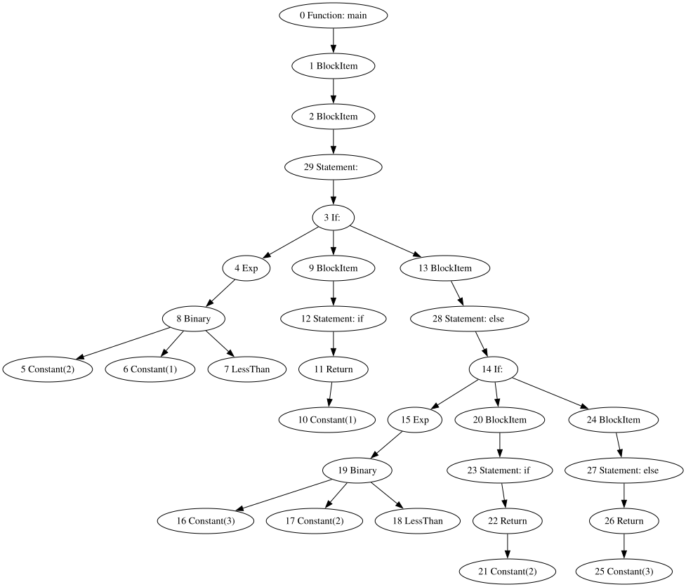

# AST, Identifier Resolution and Semantic Analysis

## Difference between Parse Tree and AST

The LALR(1) parser will follow all production rules in the grammar meticulously because it was constructed from the grammar. When writing down the graph of all production rules that have been reduced and connecting them together in the order in which they have been reduced, you will get the parse tree. Remeber the first sketch drawing in the Lexer section? This sketch shows the parse tree including all production rules use to accept the short C-application.

Some of the production rules used in a grammar contain cases that allow the grammar to string from one rule to the next, skipping a rule if it does not add real information but is only strung together to arrive at a LALR(1) grammar that is somewhat unambiguous and can be parsed correctly.

As an example, take a look at these rules:

```
conditional_expression -> logical_or_expression QUESTION_MARK expression COLON conditional_expression
conditional_expression -> logical_or_expression

logical_or_expression -> logical_and_expression OR_OP logical_or_expression
logical_or_expression -> logical_and_expression

logical_and_expression -> inclusive_or_expression AND_OP logical_and_expression
logical_and_expression -> inclusive_or_expression

inclusive_or_expression -> exclusive_or_expression OR inclusive_or_expression
inclusive_or_expression -> exclusive_or_expression
```

You can see that especially for expressions, a rule either contains an operator and it's two operands (the upper rule) or it just strings along the parser to the next rule in line (the lower rule). The parse tree will contain all the productions even if they do not contain any information.

The parse tree is what the parser gives us for free as it follows the parse table content.

It contains every token and non-literal. It describes that a return statement must be followed by a semicolon. An abstract syntax tree is abstract and leaves out information not required for later stages. For example it does not contain information about semicolon. In that sense an AST is an abstract representation of an application whereas the parse tree is a literal or concrete representation of an application.

## Building a condensed Parse Tree (This is not an AST)

A more condensed parse tree with less filler nodes can be created by setting the parser's *collapse_nodes* property to true. Then, the parser will not ouput nodes that connect to one individual node only.

This condensed tree is not used in the following. It was a test to see if an AST can automatically be generated. The AST that is ultimately used is hand-crafted since it contains nodes that are too complex to create by condensing the tree.

## Building the AST from the Parse Tree

For further processing, the compiler can get away with a more compact tree. This more compact tree is called abstract syntax tree (AST).

The AST is something that we need to build ourselves manually! It will be hand-crafted as the parser reduces individual rules.
The AST contains custom nodes that are indirectly put together as the parse tree is constructed.



The AST tree contains pure information without grammar bloat. Also the parse tree has left- or right-recursive structure. This means that a flat list is not modeled as a large set of sibling nodes but each sibling is nested into the prior sibling. In the AST this recursive structure of siblings is linearized into a set of siblings on the same tree level.

## Formalizing the AST structure

In Nora Sandler's book, the AST is described by a grammar which is extended as the book progresses throught the chapters and language constructs. Note: The AST grammar is not the same as TACKY! The TACKY intermediate language is another step in compilation.

Each mentioning of the AST or AST grammar in the book represents a new iteration where elements may have been added or extended
relative to the prior iterations. This section sums up all the changes.

The AST grammar description syntax is:
* The or | operator lists alternatives.
* The ? operation marks a part as optional.
* The * operation marks a part as repeated zero or more times.

Page 13

```
program = Program(function_definition)

function_definition = Function(identifier name, statement body)

statement = Return(exp)

exp = Constant(int)
```

Page 14

```
statement =
    Return(exp)
    | If(exp condition, statement then, statement? else)
```

Page 33

```
exp =
    Constant(int)
    | Unary(unary_operator, exp)

unary_operator =
    Complement
    | Negate
```

Page 40 - This is not for the normal AST but for the Assembly AST!

Page 48

```
exp =
    Constant(int)
    | Unary(unary_operator, exp)
    | Unary(binary_operator, exp, exp)

binary_operator = Add | Subtract | Multiply | Divide | Remainder
```

Page 73

```
unary_operator =
    Complement
    | Negate
    | Not

binary_operator = Add | Subtract | Multiply | Divide | Remainder
    | And | Or | Equal | NotEqual | LessThan | LessOrEqual | GreaterThan | GreaterOrEqual
```

Page 97

```
exp =
    Constant(int)
    | Var(identifier)
    | Unary(unary_operator, exp)
    | Unary(binary_operator, exp, exp)
    | Assignment(exp, exp)
```

Page 98

```
statement =
    Return(exp)
    | Expression(exp)
    | If(exp condition, statement then, statement? else)
    | Null

declaration = Declaration(identifier name, exp? init)
```

Page 99

```
block_item = S(statement) | D(declaration)

function_definition = Function(identifier name, block_item* body)
```

Page 100 - contains the entire AST grammar so far.

Page 118

```
statement =
    Return(exp)
    | Expression(exp)
    | If(exp condition, statement then, statement? else)
    | Null
```

Page 121

```
exp =
    Constant(int)
    | Var(identifier)
    | Unary(unary_operator, exp)
    | Unary(binary_operator, exp, exp)
    | Assignment(exp, exp)
    | Conditional(exp, condition, exp, exp)
```

Page 135

```
function_definition = Function(Identifier name, Block body)

block = Block(block_item*)

block_item = S(statement) | D(declaration)

statement =
    Return(exp)
    | Express(exp)
    | If(exp condition, statement then, statement? else)
    | Compound(block)
    | Null
```

This page also has a complete overview of the AST grammar up to this point.

Page 149 - adds AST rules for loops and loop init

Page 150 - adds labels

```
for_init = InitDecl(declaration) | InitExp(exp?)

statement =
    Return(exp)
    | Express(exp)
    | If(exp condition, statement then, statement? else)
    | Compound(block)
    | Break(identifier label)
    | Continue(identifier label)
    | While(exp condition, statement body, identifier label)
    | DoWhile(exp condition, statement body, identifier label)
    | For(for_init init, exp? condition, exp? post, statement body, identifier label)
    | Null <----- ???
```

Page 159 - Switch Statements

Hint: Page 159 - Switch statements are not explicitly defined but left as an extra credit excercise for the reader.
TODO: Switch Statements

```
statement =
    ...
    | Switch

Switch =
    Case*(Constant selector, Statement body)        // Statement body can resolve to Compound which contains a block
    | Default(Statement body)
```

Page 171

```
exp =
    Constant(int)
    | Var(identifier)
    | Unary(unary_operator, exp)
    | Binary(binary_operator, exp, exp)
    | Assignment(exp, exp)
    | Conditional(exp, condition, exp, exp)
    | FunctionCall(identifier, exp* args)         <------------- FunctionCall not FunctionDecl
```

Change 1:

```
function_definition = Function(Identifier name, block body)
```

is changed to

```
function_declaration = Function(Identifier name, identifier* params, block? body)
```

Change 2:

```
declaration = Declaration(identifier name, exp? init)
```

is changed to

```
declaration = FunDecl(function_declaration) | VarDecl(variable_declaration)

variable_declaration = (identifier name, exp? init)
```

Page 172
This page also has a complete overview of the AST grammar up to this point.

Page 224 - Chapter 10 - File Scope Variable Declarations and storage class specifiers
Adds Storage Class

Page 247, 248 - Chapter 11 - Long Integers
New Types, adds cast

```
type = Int | Long | FunType(type* params, type ret)

exp =
    Constant(const)
    | Var(identifier)
    | Cast(type target_type, exp)
    | Unary(unary_operator, exp)
    | Binary(binary_operator, exp, exp)
    | Assignment(exp, exp)
    | Conditional(exp, condition, exp, exp)
    | FunctionCall(identifier, exp* args)

const = ConstInt(int) | ConstLong(int)
```

Page 252 - (listing 11-7 and 11-9) adds type information to the AST Nodes

```
exp =
    Constant(const, type)
    | Var(identifier, type)
    | Cast(type target_type, exp, type)
    | Unary(unary_operator, exp, type)
    | Binary(binary_operator, exp, exp, type)
    | Assignment(exp, exp, type)
    | Conditional(exp, condition, exp, exp, type)
    | FunctionCall(identifier, exp* args, type)
```

Page 276 - Chapter 12 - Unsigned integers

```
type = Int | Long | UInt | ULong | Double | FunType(type* params, type ret)

const = ConstInt(int) | ConstLong(int) | ConstUInt(int) | ConstULong(int)
```

2^31     = 2.147.483.648 =   10000000_00000000_00000000_00000000
2^31 - 1 = 2.147.483.647 =   01111111_11111111_11111111_11111111

2^32     = 4.294.967.296 = 1_00000000_00000000_00000000_00000000
2^32 - 1 = 4.294.967.295 =   11111111_11111111_11111111_11111111

2^64     = 18.446.744.073.709.551.616 = 1_00000000_00000000_00000000_00000000_00000000_00000000_00000000_00000000
2^64 - 1 = 18.446.744.073.709.551.615 =   11111111_11111111_11111111_11111111_11111111_11111111_11111111_11111111

To determine the sub-type of const (ConstInt(int) | ConstLong(int) | ConstUInt(int) | ConstULong(int)),
the following rules are used.

- If the number has no negative sign, then the number is interpreted as unsigned
- The compiler will fit the number into the smallest type that can safely hold the value

Page 305, 306 - Chapter 13 - Floating Point Numbers

```
type = Int | Long | UInt | ULong | Double | FunType(type* params, type ret)

const = ConstInt(int) | ConstLong(int) | ConstUInt(int) | ConstULong(int) | ConstDouble(double)
```

Page 354, 355 - Chapter 14 - Pointers

```
type = Int | Long | UInt | ULong | Double | FunType(type* params, type ret) | Pointer(type referenced)

exp =
    Constant(const, type)
    | Var(identifier, type)
    | Cast(type target_type, exp, type)
    | Unary(unary_operator, exp, type)
    | Binary(binary_operator, exp, exp, type)
    | Assignment(exp, exp, type)
    | Conditional(exp, condition, exp, exp, type)
    | FunctionCall(identifier, exp* args, type)
    | Dereference(exp)
    | AddrOf(exp)
```

Page 359

??? (TACKY ???)
```TACKY
declarator =
    Ident(identifier)
    | PointerDeclarator(declarator)
    | FunDeclarator(param_info* params, declarator)

param_info = Param(type, declarator)
```

Page 363 - Overview over the grammar. Also in some way an overview of the AST grammar.

Page 393, 394 - Chapter 15 - arrays

```
variable_declaration = (identifier name, initializer? init)

initializer =
    SingleInit(exp)
    | CompoundInit(initializer*)

type =
    Int
    | Long
    | UInt
    | ULong
    | Double
    | FunType(type* params, type ret)
    | Pointer(type referenced)
    | Array(type element, int size) // new

exp =
    Constant(const, type)
    | Var(identifier, type)
    | Cast(type target_type, exp, type)
    | Unary(unary_operator, exp, type)
    | Binary(binary_operator, exp, exp, type)
    | Assignment(exp, exp, type)
    | Conditional(exp, condition, exp, exp, type)
    | FunctionCall(identifier, exp* args, type)
    | Dereference(exp)
    | AddrOf(exp)
    | Subscript(exp, exp) // new, first exp is a pointer to the array, second exp is the index to access (page 393)
```

??? (TACKY ???)
```TACKY
declarator =
    Ident(identifier)
    | PointerDeclarator(declarator)
    | ArrayDeclarator(declarator, int size)
    | FunDeclarator(param_info* params, declarator)
```

Page 432 - Chapter 16 - strings

Page 463/464 - Chapter 17 - Supporting Dynamic Memory Allocation (Sizeof operator: page 462)

```
type =
    Char
    | SChar
    | UChar
    | Int
    | Long
    | UInt
    | ULong
    | Double
    | Void // new
    | FunType(type* params, type ret)
    | Pointer(type referenced)
    | Array(type element, int size)
```

```
statement =
    ...
    | Return(exp?) // changed: exp is now optional
    ```
```

```
exp =
    SizeOf(exp)
    | SizeOfT(type)
```

Page 495/496 - Chapter 18 - Structures

```
declaration =
    FunDecl(function_declaration)
    | VarDecl(variable_declaration)
    | StructDecl(struct_declaration) // new

struct_declaration = (identifier tag, member_declaration* members) // new

member_declaration = (identifier member_name, type member_type) // new

type =
    Char
    | SChar
    | UChar
    | Int
    | Long
    | UInt
    | ULong
    | Double
    | Void
    | FunType(type* params, type ret)
    | Pointer(type referenced)
    | Array(type element, int size)
    | Structure(identifier tag) // new

exp =
    Constant(const, type)
    | Var(identifier, type)
    | Cast(type target_type, exp, type)
    | Unary(unary_operator, exp, type)
    | Binary(binary_operator, exp, exp, type)
    | Assignment(exp, exp, type)
    | Conditional(exp, condition, exp, exp, type)
    | FunctionCall(identifier, exp* args, type)
    | Dereference(exp)
    | AddrOf(exp)
    | Subscript(exp, exp)
    | SizeOf(exp)
    | SizeOfT(type)
    | Dot(exp structure, identifier member) // new
    | Arrow(exp pointer, identifier member) // new
```

------- Here the Chapter on Optimization starts -------

------- I have not checked for AST changes beyond this point -------